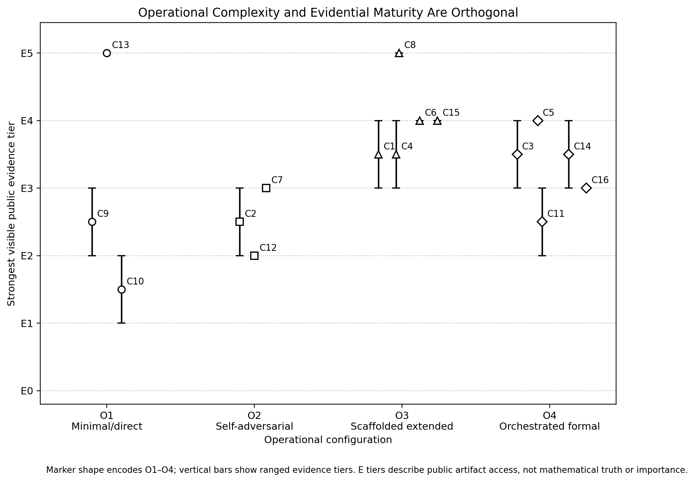

# 引言

2026 年公开的 AI 辅助数学案例开始披露的不只是最终答案。一些作者记录了如何筛选问题、如何确定目标、如何并行维护不同路线、如何攻击候选证明，以及形式系统或可执行程序怎样改变原有论证。过程变得更可见之后，证据也更难阅读：根帖、共享聊天、代码仓库、一次成功的 Lean 构建和后来写成的人类证明，回答的是不同问题。

本文关注过程及其证据边界，而不是统计“解决了多少题”。对于每个 episode，我们追问：目标如何被选择，候选结果如何产生、遭到质疑、被修复和检查；模型、工具与人类分别做了什么；哪些材料仍然缺失；现有工件究竟允许我们提出多强的主张。

语料包含 16 个公开工作流 episode。其中包括两个带有多个嵌套目标的 campaign、四个 Erdős 问题形式化 episode、一个精确检查器风险案例、单位距离问题的长轨迹与后续成熟化、两个极简提示或有限证书案例、一个 Devin 编排流程、Erdős #477 的透明候选证明、Erdős #1196 的表示法突破、Erdős #870 的超大规模 Lean 工程、一个内部模型三道短证明的成熟化流程，以及一个计算社会选择案例：五投票者桥接归约、另一模型留下的失败笔记、三投票者最终归约和两套 Lean 仓库构成同一条连续支持路径。

本文围绕四个问题展开：

1. 哪些工作流组件在彼此独立组织的 AI 数学 episode 中反复出现？
2. 实质性错误通常从哪里进入，哪些机制能够消除错误，哪些机制只是把错误转移到别处？
3. 语言模型、证明助手、精确程序、人类数学家和公共评审者之间怎样分工？
4. 哪些观察可能迁移到科学和工业研究，哪些依赖数学特有的验证条件？

公开证据能够支持的核心判断是：

> **在最可信的公开案例中，AI 辅助数学主张的强度取决于外围研究系统——目标选择、验证、修复和评审——而不只取决于基础模型或某条提示词。**

这个系统包括语义绑定、搜索预算、状态连续性、对抗审查、确定性验证、修复谱系、人类介入和外部成熟化。

## 贡献

本文的贡献主要有五项：

1. 以六维证据卡重建 16 个公开工作流 episode，覆盖 26 个以上数学目标。
2. 提出两种正交描述：九个工作流组件，以及 O1–O4 操作配置与 E0–E5 公开证据层级的二维映射。
3. 对公开可见的人类劳动做保守的下界编码，避免用一个笼统的“完全自主”标签抹去选题、修复、形式化和成熟化工作。
4. 冻结编码手册，给出描述统计和逐案例机制矩阵，并把四项机制写成等预算、可对照的实验假说，而不是因果结论。
5. 总结八类失效模式及其控制措施，提供机器可读证据账本，并区分数学特有的验证优势与尚待检验的通用研究工程假说。

## 主张边界与效度威胁

语料因“公开过程可见”而入选，必然受到幸存者偏差和披露偏差影响。下面的频数不能解释为总体成功率，也不能用于因果推断。

Version 0.10 仍由一名分析员编码。冻结代码本、JSON Schema 和自动交叉检查能够减少录入漂移，但不能建立解释一致性。本文不报告 Cohen's $\kappa$、加权 $\kappa$ 或 Krippendorff's $\alpha$。所有计数只描述这批冻结语料和本次编码。

## 相关工作：受控基准与野外观察证据

Gödel Test、基于 Gemini 的 700 道 Erdős 问题扫描、Formal Conjectures、Automated Conjecture Resolution、LEAP 和大规模形式证明搜索，都在预先设定的目标集和评估制度下研究模型能力。它们回答的是固定任务、正式目标和系统性能问题。

本文属于另一种研究：**野外观察性案例系列**。这些 episode 由不同操作者自行组织，证据散落在社交媒体跟帖、共享对话、论文、代码仓库、公开纠正、问题网站和后来的人类论文中。本文的贡献是过程取证和跨工作流比较，而不是重新建立一个求解基准。

# 方法

## 语料与纳入标准

当一个 episode 至少公开了以下两类材料时，本文才将其纳入：连续跟帖；公开对话或提示；论文或技术报告；代码或证明助手工件；明确修复或纠正；外部评审；异常详细的路线历史。

受控基准和大型形式搜索项目放入相关工作，而不计入观察语料。只有根帖、无法确认目标、或完全找不到过程与工件的公开主张被排除。排除是方法学决定，不表示对应数学一定错误。

**可见人类劳动等级。** `L0` 表示公开证据中只有极少的启动与发布工作；`L1` 表示有限但实质的筛选、清理、检查或单研究者协调；`L2` 表示持续多日或团队级的重构、形式化、简化和成熟化；`L?` 表示公开材料不足。这些都是可见劳动的下界，不包括模型运行时间。

**表 1. 核心工作流 episode 与最强可见公开证据。**

| ID | Episode 与目标 | 模型或系统 | 人类劳动 | 最强可见公开证据 |
|---|---|---|:---:|---|
| **C1** | Shouqiao Wang，六个 Erdős 目标 | GPT-5.6 Sol、Codex、部分 Lean | **L2** | 多份手稿及部分 Lean/CI 工件；各目标成熟度不一致 |
| **C2** | Adam Holter，十候选 campaign | GPT-5.6 Pro、同模型审计 | **L?** | 十个公开 Pro 会话和部分精确检查；未经同行评审，审计高度相关 |
| **C3** | David Turturean 等，Erdős #330 | ChatGPT-5.5 Pro、脚手架、Lean | **L1** | 公开 Lean 包和社区 PROVED (LEAN) 状态；完整聊天不可见 |
| **C4** | Liam Price 等，Erdős #635 | GPT-5.2 Pro、Aristotle | **L1** | 一个子问题的 Lean 工件及对更宽主张的公开降级 |
| **C5** | Pietro Monticone 等，Erdős #650 | GPT-5.4 Pro、Aristotle、Lean | **L2** | Lean 证明和人类论文；原自然语言证明的关键步骤被替换 |
| **C6** | Acer 等，Erdős #728 | GPT-5.2 Pro、Aristotle | **L2** | 目标重构后的 Lean 证明、人类说明和公开讨论 |
| **C7** | Adam Holter，固定周长猜想 1.2 | GPT-5.6 Pro、Python 精确检查器 | **L1** | 破坏式审查、修复证明和数百万有限检查；没有证明内核工件 |
| **C8** | OpenAI 单位距离反驳 | 内部模型、AI grading、人类编辑 | **L2** | 公开证明、重写轨迹、九人证明和后续加强 |
| **C9** | Dmitry Rybin，Dinitz–Garg–Goemans 反例 | GPT-5.6 Pro | **L2** | 具体有限图及作者报告的独立检查；完整会话与检查器不全 |
| **C10** | Anirudh Chakravarthy，两个极简提示目标 | GPT-5.6 Sol Pro | **L0** | 作者报告存在技术报告，但本地捕获与验证有限 |
| **C11** | Jared Zoneraich/Devin，图论批量流程 | Devin、Fable、GPT-5.6 Sol、Lean | **L?** | 作者报告有仓库、视频和无 `sorry` 构建；目标到构建的映射未固定 |
| **C12** | Patrick White/MathDyad，Erdős #477 | GPT-5.6 Sol；Claude 来源检查 | **L1** | 可审计候选轨迹和有限范围审查；没有 Lean 证明或完整专家验证 |
| **C13** | Liam Price、Jared Duker Lichtman 等，Erdős #1196 | GPT-5.4 Pro；后续人类论文与 Lean | **L2** | 多作者证明、公开形式化和专家/策展人成熟化 |
| **C14** | David Turturean，Erdős #870 | ChatGPT-5.5 Pro、Codex、Claude Opus 4.8、Lean 4 | **L2** | 作者报告约 18 万行、无 `sorry`/额外公理；尚未固定干净重建 |
| **C15** | Alexeev、Putterman、Sawhney、Sellke、Valiant，三个 Erdős 问题 | OpenAI 内部模型；GPT-5.4 Pro 复现尝试 | **L2** | 六页人类论文和部分公开模型复现；内部轨迹不可见 |
| **C16** | Dominik Peters，三投票者 Kemeny 排序聚合 | GPT-5.6 Sol Ultra、Claude Fable 5、Lean 4 | **L2** | arXiv 论文和两个公开 Lean 仓库；独立评审与干净重建待完成 |

## 分析单位与编码规则

一个 **研究工作流 episode** 定义为：

> 同一操作者或协调团队 + 有界时间窗口 + 大体共享的编排和支持路径。

根帖、共享聊天、论文、仓库、纠正和后续评审在支持同一次运行时，只是该 episode 内的证据对象。批量 campaign 中不同定理目标记为嵌套子 episode，而不是彼此独立的工作流样本。Holter 的十个 Pro 会话因此计为一个 campaign 和十个任务级子 episode；他的固定周长流程则因目标、提示、修复历史和支持路径不同而单独计数。

后来被更强定理覆盖的中间结果，如果明确推动了后续搜索，记为**桥接结果**。模型或人类之间传递的失败笔记、脚本、部分构造、来源映射和开放义务，记为**交接工件**。

## 编码手册与可靠性状态

工作流和机制矩阵采用三值编码：

- `[Y]`：冻结证据中存在直接且针对该主张的支持；
- `[P]`：部分可见、作者报告、间接支持或来源绑定未解决；
- `[-]`：当前语料未建立该特征，不表示它一定没有发生。

O、E、L 等序数标签在证据不均时采用最低可辩护等级。机制是否存在与机制是否产生结果分开编码。

当前版本只有一名编码者。确认性版本应让第二名编码者在看不到第一组标签的情况下盲编，保存裁决前标签，报告原始一致率和字段级信度，并公开争议日志。

## 六维证据卡

| 维度 | 审计问题 | 典型的非蕴含关系 |
|---|---|---|
| **过程溯源** | 提示、时间、分支、人工介入和修复是否可见、经作者证明或缺失？ | 结果公开不等于过程完整 |
| **工件可用性** | 论文、代码、形式目标、日志和数据能否检查、是否有版本？ | 文件存在不等于成功执行 |
| **确定性验证** | 精确形式定理是否通过内核，或程序是否在声明范围内 fail-closed 地检查？ | 内核或检查器不证明目标绑定和新颖性 |
| **独立评审** | 是否由不同谱系的评审者检查了相关主张，范围是否说明？ | 同模型重复不因次数而获得独立性 |
| **新颖性与先验工作** | 相对于什么语料、在什么时间搜索了什么结论、证明或方法？ | “未找到”不等于全球新颖，也不等于训练中没有 |
| **自主性与归属** | 模型、操作者、形式化器、精确工具和后来数学家分别完成了哪些环节？ | 一个“AI-only”标签会抹去关键介入 |

## 术语

- **形式化器**：在形式环境中翻译、补全、修复或替换论证的系统，如 Aristotle 与 Lean 的组合。
- **检查器**：在声明的有限或符号范围内运行的精确可执行程序。
- **验证器**：证明内核、形式化结果检查和精确检查器的统称。

形式化器可能是研究贡献者；检查器有明确的证据上限；验证器本身不是独立评审者。

## 模型标签归一化

本文按案例作者的公开表述记录模型名称，它们只是来源标签，不是标准化实验条件。同名产品可能对应不同后端快照、系统提示、工具、上下文、预算和代理封装。

| 作者报告的标签 | Episode | 本文处理方式 |
|---|---|---|
| GPT-5.2 Pro | C4、C6 | 不假定与后续 Pro/Sol 模式等价 |
| GPT-5.4 Pro | C5、C13、C15 | 与内部模型、形式化器及后来的人类推导分开记录 |
| ChatGPT-5.5 Pro | C3、C14 | 保留产品名；精确服务快照与工具上下文不可见 |
| GPT-5.6 Pro | C2、C7、C9 | 同名不意味着提示、工具和后端相同 |
| GPT-5.6 Sol / Sol Pro | C1、C10、C11、C12 | 不合并为一个受控条件 |
| GPT-5.6 Sol Ultra | C16 | 作为 Codex 产品中的多子智能体配置单独记录 |
| Codex | C1、C14、C16 | 编码、工件、形式化或多智能体编排角色 |
| Aristotle | C4–C6 | 形式化器；C5 中还承担证明修复 |
| Devin / Fable | C11 | 控制器和专家代理栈；待仓库重建 |
| Claude | C12、C14、C16 | 来源检查、编译驱动、简化或失败笔记；不等于完整独立验证 |
| OpenAI 内部模型 | C8、C15 | 精确公开服务标识不可得；不假定等价于公开产品 |

## 来源收集与缺失证据

每个社交媒体案例被视为事件流：根帖、作者回复、共享聊天、附件、仓库、纠正和当前问题状态均单独记录。证据快照为 2026 年 7 月 30 日。动态页面按完整捕获、部分捕获或仅 URL 标记。公开不可变存档完成前，本文不声称所有会话已经长期归档。

C16 由 arXiv:2607.25540 固定，两个公开仓库分别是 `DominikPeters/KemenyHardnessLean` 和 `DominikPeters/HardnessReductionsLean`。本次审计尚未完成独立干净构建，也没有固定精确 commit 对，因此暂记 E3 provisional，而不是独立确认的数学结论。

## 不报告成功率

公开案例是事后选择的，题目年龄、歧义、证书成本和发布动机会改变哪些结果被看见。因此本文不报告总体成功率。未来基准应预注册目标集，并计算：

$$
\mathrm{SR}(\tau)=\frac{|S(\tau)|}{|A|},
$$

其中 $A$ 是所有预注册尝试，$S(\tau)$ 是满足预先规定证据门槛 $\tau$ 的尝试。放弃、超时、发现重复后终止、范围无效和撤回的尝试都应保留在分母中。$\tau$ 可以包含 E0–E5 的工件门槛，但还必须规定目标绑定、精确检查、评审和新颖性条件。

# 案例重建：五个机制深描与十一个紧凑案例

正文选择五个案例作较详细分析：C5（形式化器修复）、C7（破坏式审查与检查器风险）、C8（路线替换）、C12（透明但审查范围有限的候选证明），以及新增的 C16（桥接结果与跨模型交接）。其余十一个案例在表 2a、2b 中压缩呈现，较长说明保留在附录 F。

**表 2a：C1—C9 的紧凑案例说明。**

| 案例与工作流信号 | 当前证据边界 | 主要过程推断 |
|---|---|---|
| **C1——契约式并行搜索**：先筛题，再明确可接受证据，并保持多条不兼容路线。 | 不同输出的成熟度差异很大；公开范围修正与 prior art 问题使 campaign 级成功率不可计算。 | “选择攻哪些题”和“在单题内怎样管理路线”是两个应分别建模的组合问题。 |
| **C2——高吞吐嵌套 cohort**：在相对稳定的操作者和审计方式下处理十个任务级会话。 | 同模型审计确实发现缺陷，但相关性很强；完整分母与独立评审不足。 | 一个 campaign 可以包含十个子任务，但不应被写成十个独立成功实验。 |
| **C3——端到端形式化**：自定义脚手架、语义选择、手稿和 Erdős #330 的公开 Lean 支持路径。 | 内核接收只适用于编码后的定理；完整聊天来源和自然语言—形式目标等价性仍是独立义务。 | 形式化从语义绑定开始，而不是从写第一行 Lean 开始。 |
| **C4——公开降级**：一个两部分问题在专家审查后被拆分，其中一部分仍然开放。 | 修正收窄了复合主张，但没有抹除有效子结果。 | 成熟系统必须允许部分结果和按依赖范围传播的降级。 |
| **C6——目标重构**：人类与模型先重构一个有意义的 #728 目标，再完成形式化和人类化表达。 | 导航、文献、叙述和 prior art 都 materially 影响贡献，因此自主性和新颖性不能用单一标签概括。 | 目标重构可以构成贡献，但必须记录它相对原问题的语义变化。 |
| **C9——有限证书不对称**：经过数周人类思考后，GPT-5.6 Pro 给出具体图反例。 | 有限证书便于检查，但完整聊天、公开精确程序和成熟论文尚未全部固定。 | 提示词有多简单，不如证书是否紧凑、可检查重要。 |

**表 2b：C10—C16 的紧凑案例说明。**

| 案例与工作流信号 | 当前证据边界 | 主要过程推断 |
|---|---|---|
| **C10——极简提示下的选题与求解**：一句话将选题、搜索和写作交给模型。 | 技术报告和完整跟帖尚未完整捕获，因此仍属于过程假说，而不是成熟定理证据。 | 极简提示不能证明数学专家或后续验证不再需要。 |
| **C11——控制器驱动的批量研究**：Devin 被报告为协调选题、并行代理、Lean 转写和对抗检查。 | 冻结语料尚缺固定仓库、定理—构建映射和独立 clean rebuild。 | 系统复杂度本身不会产生可审计证据。 |
| **C13——表示法逃逸与专家成熟化**：GPT-5.4 Pro 在 #1196 中采用 von Mangoldt 权重，绕开领域惯常的概率化开局。 | 多作者论文、形式化与社区成熟状态支持定理，但原始完整会话和转化时间线仍不完整。 | 模型可能通过改变表示法产生价值；专家仍负责解释、推广和持久表达。 |
| **C14——超大规模形式化**：约 18 万行 Lean、多个模型与自建编译循环。 | 公开过程说明很详细，但本文尚未固定精确仓库、commit、依赖和独立重建。 | 研究级自动形式化会转化成软件工程、依赖和状态管理问题。 |
| **C15——内部生成与人类消化**：内部模型给出三份短证明，五位数学家整理成论文，公开 GPT-5.4 Pro 的复现并不完全。 | 论文可检查且贡献说明较清楚，但内部轨迹和完整分母不可见。 | 核心想法归于模型，也不等于发表级数学知识无需大量人类加工。 |
| **C16——桥接结果与跨模型交接**：先得到复杂的五投票者归约，再利用 Claude 失败笔记与脚本推进到三投票者 Kemeny NP-hardness。 | 论文和两个 Lean 仓库公开；本次审计未完成固定 commit 的独立 clean rebuild，也没有独立同行评审。 | 被最终结果包含的中间结果和失败笔记，仍可能是因果上不可缺少的研究资产。 |

## C5：形式化器作为共同作者——Aristotle 改写了证明

Erdős #650 的协作流程包含人类数学家、GPT-5.4 Pro、Aristotle 与 Lean。GPT-5.4 Pro 先给出非形式化论证，但人类团队发现其中一个声称为单射的映射并不成立。这个问题不是少写了一行代数，而是切断了原有支持路径。

Aristotle 的作用因而超出了转写。形式化过程中，它找到了一个不同的注入构造，绕过原来的错误步骤。数学家再从 Lean 项中重建该论证，并将其写成人类可读的证明。内核接收的是新路径所支持的形式定理，而不是最初的自然语言草稿。

这一区别同时影响证据与署名。形式文件可以支持定理，却不能追认被它替换的旧证明。当形式化器改变承重论证时，修复必须进入证明谱系，形式化器也应被视为研究贡献者，而不只是最后盖章的工具。

## C7：对抗式自修复与精确检查器风险——固定周长猜想 1.2

Adam Holter 先要求 GPT-5.6 Pro 选择并解决 Gray 等人的一个开放猜想，随后明确要求模型“杀死”自己的证明。第二轮发现了初始论证中的边界缺陷。模型删除错误步骤、改写近似，并生成 Python 程序检查数百万个有限实例。

修复提高了候选结果的可信度，同时也证明第一份“完整证明”并不完整。因此审计记录不能只保存最后版本，还应保存缺陷、出现范围、被否决工件和替代论证。否则最有价值的错误—修复转变会被抹去。

该程序又暴露出另一层问题：关键条件使用 Python `assert`，而 `python -O` 会删除这些断言，程序仍可能打印成功。公开材料支持“发现此失效模式”，并据此提出 fail-closed、执行检查清单、环境捕获和负向变异测试等要求；除非修复版程序与变异日志公开，本文不把这些加固步骤写成已完成。几百万次检查只有在检查器本身能够可靠失败时才构成证据。

## C8：不是局部补丁，而是路线替换——单位距离案例

单位距离案例拥有本语料中最成熟的外部支持路径之一：公开证明、125 页重写研究轨迹、九位数学家整理的独立人类证明，以及随后对指数的加强。需要区分的是，125 页文档是由研究轨迹整理而来的重写过程材料，并不是未经删节的实时原始日志。

其方法学价值来自路线替换。模型早期尝试了关联计数、Fourier、加法组合、数域和相对单位等方向；“almost-totally-real”路线因高度和格形成本被否决。之后系统保留 CM 符号理想和 cut-and-project 的下游几何内核，但用 cyclic-cubic pro-3 tower 替换上游存在性机制。最终又经历人类重推、压缩与加强。

```text
关联计数 / Fourier / 加法组合路线
    → 数域与相对单位构造
    → almost-totally-real 路线被否决
    → 保留 CM sign-ideal 与 cut-and-project 内核
    → cyclic-cubic pro-3 tower 替换上游机制
    → 人类重推、压缩并获得显式加强
```

失败路线没有变成无用噪声；它们暴露了后续路线必须支付的高度、格形、分母和一致性成本。该案例说明，负面知识、路线历史和结果成熟化都是研究记录的一部分。

## C12：可审计但审查范围有限的候选证明——Erdős #477

**本文纳入这一案例，是因为其过程透明，而不是因为它已成为公认突破。**

`pw/erdos477-cubic` 仓库声称对每个整数幂 $K\ge3$ 构造铺砌补集。核心构造由 GPT-5.6 Sol 产生，随后使用同一模型家族的不同会话作攻击，Claude 则进行来源核查、初等代数重推、指数复算和更正记录。

审计确实发现了问题，包括引用不匹配和偶数 $K$ 情形下错误的 genus-drop 公式。仓库说明该错误不影响主定理，因为主路线依赖绝对不可约性而非该 genus 计算。这是一份很好的“缺陷—影响范围—保留支持路径”记录。

但证据上限仍然有限：完整模型会话未公开，同家族审计不能算独立验证，Claude 的检查不覆盖整份证明，也没有 Lean 证明或数论专家的完整审查。自然语言目标与形式代码之间还存在范围差异。故 C12 被归为“可审计候选轨迹”，而非已验证突破。

## C16：桥接结果与跨模型交接——三投票者 Kemeny 排序聚合的 NP-hardness

Dominik Peters 的案例补充了一条此前语料中较少见的完整链条。该问题询问 Kemeny 排序聚合在只有三个输入排名时是否仍然 NP-hard，长期处于开放状态。Peters 此前多次让模型尝试较弱的五投票者情形，却发现模型总想把既有 Conitzer 归约强行嵌入这一表示。他因此在新任务中显式记录“不要沿旧路线继续”的负面约束，并向模型提供原始文献。

GPT-5.6 Sol Ultra 先在一次长运行中找到复杂的五投票者归约。这个结果后来被更强的三投票者定理覆盖，但它不是无价值的失败；它提供了可传递的结构、gadget 和证明骨架。之后 Claude Fable 5 与 GPT-5.6 参与简化。Claude 没有独立完成三投票者版本，却留下笔记和脚本。下一次 GPT-5.6 Sol Ultra 将五投票者结果与这些失败材料一并使用，最终获得三投票者归约。

Peters 随后承担大量人工工作：判断什么构造过于复杂、提出如 long even edges 等简化、把可行但难读的证明写成论文，并建立 Kemeny 专用 Lean 工程。另一个公开仓库又将这次工作抽象为更一般的 NP-hardness reductions Lean 库。这里发生的不是“一个模型一次回答”，而是：

```text
领域专家识别旧死路
    → 负面约束进入新提示
    → 模型得到较弱桥接结果
    → 另一个模型留下失败笔记和脚本
    → 后续模型利用这些残余突破更强目标
    → 人类做结构简化与论文写作
    → Lean 形式化并沉淀为通用方法库
```

该流程支持四个方法学判断。第一，最终被包含的中间结果仍可能是发现路径中的桥梁。第二，失败输出在绑定了已知事实、死路和开放义务后，可以成为跨模型交接工件。第三，“不要再走某条路线”应作为带证据与可重开条件的搜索资产，而非永久禁令。第四，证明简化是一个独立阶段：正确但复杂的证明，与可供人类审查、维护和复用的证明，具有不同的研究和工程价值。

当前 C16 暂编码为 O4、E3 provisional、L2。公开论文和两个 Lean 仓库使其工件基础较强，但本文尚未完成精确 commit 对的独立重建，也没有把领域作者自己的核查算作完全独立评审。

# 跨案例综合

## 九个工作流组件

与其把案例硬分成互斥范式，不如用组件向量描述。

| 代码 | 组件 | 操作性问题 |
|---|---|---|
| **P** | 问题组合管理 | 如何按重要性、可解性、歧义、prior art 与证书成本筛题？ |
| **G** | 目标绑定与规格化 | 定义、量词、claim atoms 与不可接受捷径是否明确？ |
| **T** | 搜索拓扑 | 搜索是顺序、并行、批量还是控制器驱动？ |
| **M** | 状态与轨迹管理 | 失败路线、开放义务、既往尝试与负面知识是否保留？ |
| **F** | 证伪拓扑 | 谁负责攻击候选结果，其独立性如何？ |
| **V** | 形式化或可执行验证 | 精确检查了哪个定理或有限范围，环境是什么？ |
| **R** | 修复语义 | 证明是转写、补全、局部修复、替换，还是改了目标？ |
| **H** | 人类语义与领域介入 | 人类在哪些环节选题、导航、绑定、解释或批准？ |
| **E** | 外部成熟化 | 是否经历 prior-art 裁决、独立重推、纠正、简化或加强？ |

## 四种操作配置

操作复杂度与证据成熟度彼此正交。

| 等级 | 配置 | 主要特征 | 示例 |
|---|---|---|---|
| **O1——极简/直接** | 一条提示或一个可见会话 | 在单次交互中完成选题、证明或证书 | C9、C10、C13 |
| **O2——自我对抗** | 先生成，再明确攻击 | 局部目标从完成切换为寻找致命缺陷 | C2、C7、C12 |
| **O3——脚手架化长程运行** | 契约目标、持久状态、多路线、长运行或内部 campaign | 路线管理、记忆和成熟化成为显式对象 | C1、C4、C6、C8、C15 |
| **O4——编排化形式流程** | 控制器或专家流水线，包含形式化/检查 | 工件在生成、批判、形式化和发布之间流动 | C3、C5、C11、C14、C16 |

## 双轴图：操作复杂度与公开证据



**图 1：操作配置与公开证据层级。** 更复杂的工作流并不自动产生更成熟的数学证据。C11 是 O4 流程，却因仓库和目标—构建绑定未固定而仅为 E2–E3 reported；C8 在 O3 经过外部人类证明和加强后达到 E5。新增 C16 位于 O4/E3 provisional：形式仓库公开，但尚缺独立重建和外部评审。

| 操作配置 | Episode 与公开工件范围 |
|---|---|
| **O1** | C9：E2–E3；C10：E1–E2；C13：E5 |
| **O2** | C2：E2–E3；C7：E3；C12：E2 |
| **O3** | C1：E3–E4；C4：E3–E4；C6：E4；C8：E5；C15：E4 |
| **O4** | C3：E3–E4；C5：E4；C11：E2–E3 reported；C14：E3–E4 reported；C16：E3 provisional |

坐标也写入 JSON ledger，图并不是唯一的数据载体。

## 编码语料的描述统计

以下数字只描述这 16 个过程丰富型案例，不代表未公开 AI 数学活动的总体分布。

| 工作流组件 | 明确 `[Y]` | 部分/作者报告 `[P]` | 未建立 `[-]` |
|---|---:|---:|---:|
| 问题组合管理 **P** | 6 | 3 | 7 |
| 目标绑定 **G** | 11 | 5 | 0 |
| 搜索拓扑 **T** | 5 | 7 | 4 |
| 状态与轨迹 **M** | 8 | 8 | 0 |
| 证伪拓扑 **F** | 11 | 5 | 0 |
| 形式或可执行验证 **V** | 8 | 8 | 0 |
| 修复语义 **R** | 12 | 4 | 0 |
| 人类语义/领域介入 **H** | 15 | 1 | 0 |
| 外部成熟化 **E** | 6 | 7 | 3 |

人类介入、修复和某种形式的证伪最常被公开记录；组合筛题和外部成熟化则更不完整。这部分差异也受到纳入标准影响。

**仅作示意；小样本和序数证据层级不支持统计推断。**

| 配置 | $n$ | 可见证据范围 |
|---|---:|---|
| O1 | 3 | E1–E5 |
| O2 | 3 | E2–E3 |
| O3 | 5 | E3–E5 |
| O4 | 5 | E2–E4 |

可见人类劳动分布为：L0 1 个，L1 4 个，L2 9 个，L? 2 个。成熟结果经常伴随 L2 人类劳动，但这只是公开劳动的保守下界，不能解释成因果关系。

## 工作流指纹

`[Y]` 表示在可访问证据中明确存在；`[P]` 表示部分可见或作者报告；`[-]` 表示冻结语料没有建立该特征。

| 案例 | P | G | T | M | F | V | R | H | E |
|---|:--:|:--:|:--:|:--:|:--:|:--:|:--:|:--:|:--:|
| C1 Wang | [Y] | [Y] | [Y] | [Y] | [Y] | [P] | [Y] | [Y] | [P] |
| C2 Holter campaign | [Y] | [P] | [Y] | [P] | [Y] | [P] | [Y] | [Y] | [-] |
| C3 #330 | [-] | [Y] | [P] | [Y] | [Y] | [Y] | [P] | [Y] | [P] |
| C4 #635 | [-] | [P] | [-] | [P] | [Y] | [Y] | [Y] | [Y] | [Y] |
| C5 #650 | [-] | [Y] | [P] | [P] | [Y] | [Y] | [Y] | [Y] | [Y] |
| C6 #728 | [-] | [Y] | [P] | [P] | [Y] | [Y] | [Y] | [Y] | [Y] |
| C7 固定周长 | [Y] | [P] | [-] | [Y] | [Y] | [Y] | [Y] | [P] | [-] |
| C8 单位距离 | [P] | [Y] | [P] | [Y] | [Y] | [P] | [Y] | [Y] | [Y] |
| C9 Rybin | [-] | [P] | [-] | [P] | [P] | [P] | [P] | [Y] | [P] |
| C10 Chakravarthy | [Y] | [P] | [P] | [P] | [P] | [P] | [P] | [Y] | [P] |
| C11 Devin | [Y] | [Y] | [Y] | [Y] | [Y] | [P] | [P] | [Y] | [P] |
| C12 #477 | [-] | [Y] | [P] | [Y] | [Y] | [P] | [Y] | [Y] | [-] |
| C13 #1196 | [P] | [Y] | [-] | [P] | [P] | [Y] | [Y] | [Y] | [Y] |
| C14 #870 | [-] | [Y] | [Y] | [Y] | [Y] | [Y] | [Y] | [Y] | [P] |
| C15 OpenAI 短证明 | [Y] | [Y] | [P] | [P] | [P] | [P] | [Y] | [Y] | [Y] |
| C16 Kemeny 三投票者 | [P] | [Y] | [Y] | [Y] | [P] | [Y] | [Y] | [Y] | [P] |

## 共同生命周期

```text
选择并筛查目标
    → 固定来源、定义、量词和 claim atoms
    → 生成非等价路线，必要时设立桥接目标
    → 保存状态、开放义务、失败笔记、脚本和重复指纹
    → 在模型与人类角色之间传递可用残余
    → 用反例、破坏式批判或精确测试证伪
    → 局部修复、简化或替换上游路线
    → 形式化或检查精确声明范围
    → 寻求独立评审和 prior-art 裁决
    → 发布、纠正、简化、加强或重新打开问题
```

## 成对比较

| 比较 | 表面相似 | 决定性差异 | 过程推断 |
|---|---|---|---|
| **C3 #330 vs C5 #650** | 都有 Lean 支持路径 | C3 侧重语义选择和端到端形式化；C5 中 Aristotle 替换了承重错误步骤 | “被形式化”必须拆成目标绑定与证明关系：转写、补全、修复或替换 |
| **C9 vs C10** | 都是 O1 极简故事 | C9 有具体有限图和较多先验人类投入；C10 的报告捕获较弱 | 提示最小化不决定证据成熟度，证书形式与工件捕获更重要 |
| **C4 vs C8** | 都经历发布后审查 | C4 通过缩小复合主张成熟；C8 通过路线替换、人类重推和加强成熟 | 成熟化可以降级、保留或加强不同 claim atom，而不只是“确认” |
| **C2 vs C11** | 都跨多个目标 | C2 有公开任务会话但审计相关；C11 有复杂控制器但缺固定构建 | 吞吐量和编排复杂度解决不同问题，均不能代替证据完整性 |
| **C3 vs C14** | 都由 Turturean 主导 Lean | #870 据报需要 18 万行、多个模型与大型编译循环 | 形式化难度也是仓库、依赖、上下文与修复编排的工程尺度变量 |
| **C13 vs C15** | 核心数学都归因于 OpenAI 模型，后来由专家形成论文 | C13 的表示法被推广成研究纲领；C15 主要是把短证明变成可发表数学 | 人类消化既可能提炼新研究方向，也可能承担验证、叙述与出版转换 |
| **C8 vs C16** | 都保存失败路径并形成形式/人类可读工件 | C8 替换一条长轨迹中的上游机制；C16 将被包含的五投票者结果和另一模型的失败笔记用于更强定理 | 失败路线和被覆盖中间结果，只要记录范围和交接关系，就可以成为因果资产 |

# 机制信号与可检验假说

工作流组件矩阵描述宽泛流程，表 4 则只考察较窄的“机制—结果”关系。结果列指公开报告的实质缺陷、证伪、纠正或路线淘汰。由于语料经过选择且由单一分析员编码，下表不能支持因果或总体比例推断。

**表 4：16 个案例中的机制—结果列联。** 每个单元按 `[Y]/[P]/[-]` 报告结果：明确的实质变化、部分或歧义变化、未建立变化。

| 提议机制 | 机制明确存在 | 部分存在 | 未建立 |
|---|:---:|:---:|:---:|
| **证书不对称** | 3/0/0 | 2/1/1 | 5/3/1 |
| **破坏式批判** | 5/0/0 | 5/3/2 | 0/1/0 |
| **证明助手或精确检查器反馈** | 3/0/0 | 2/3/1 | 5/1/1 |
| **算力余量与持久状态** | 4/2/0 | 5/1/2 | 1/1/0 |

最清楚的描述性信号来自破坏式批判：所有明确采用该机制的案例都公开了实质变化。但这可能来自案例选择和披露偏差，不能解释为反事实效果或总体成功率。

| 机制 | 等预算对照实验 | 主要结果变量 |
|---|---|---|
| **证书不对称** | 固定模型和预算，随机决定选题前是否估算验证成本 | 可独立检查结果比例、人类审查时间、假完整率、证书大小 |
| **破坏式批判** | 比较一般润色、同模型 kill-pass 和不同谱系批判者 | 致命缺陷召回、有效修复率、残余假完整率、相关性调整后的审查价值 |
| **证明助手/检查器反馈** | 比较纯文本审查、精确检查器反馈和形式化器反馈 | 缺口发现、修复成功、目标忠实度、修复/替换比例、检查器假通过率 |
| **算力余量与持久状态** | 固定总 token 和工具时间，比较无状态重试与结构化轨迹记忆 | 经验证产出、重复路线率、重开义务、验证债务、可复用负面知识 |

证书不对称属于任务与证据结构，而不是对模型内部机制的臆测。破坏式批判只能作为低成本内部过滤，不能替代独立审查。形式化或检查器改变支持路径时，需要记录 delta。更长运行只有与路线记忆和验证容量结合才可能提高知识产出。

# 失效模式与控制

| 失效模式 | 公开表现 | 控制方法 | 可见案例 |
|---|---|---|---|
| **强迫闭合** | “只要完整解”把部分证据推向过度结论 | 将激进搜索持续策略与结果中立的 claim disposition 分开 | C1、C4、C7、C10 |
| **目标或范围漂移** | 一个子问题、变体或仅正整数形式化被当成原问题 | 独立重建来源、claim atoms、形式—自然语言往返检查 | C3、C4、C6、C12 |
| **相关性自审** | 同模型家族生成并攻击证明，共享盲区 | 不同谱系批判者、确定性证据、盲审专家 | C2、C7、C12 |
| **形式化洗白** | 内核接受被描述成对原自然语言证明或原问题的验证 | 精确定理绑定、公理审计、formalizer delta、细粒度归属 | C3、C5、C6、C11、C14、C16 |
| **检查器执行缺口** | 断言、超时、死分支或无条件成功信息让关键检查未运行 | fail-closed、执行清单、负向变异、环境捕获 | C7 |
| **缺失尝试分母** | 只公布成功，遗漏放弃、重复或未发布尝试 | 预注册目标集、全尝试台账、固定证据门槛 | C1、C2、C10、C11、C15、C16 |
| **prior-art 漂移或重复发现** | 有效结果后来被发现已知、相关或范围不同 | 带时间戳的检索档案；拆分定理、证明、方法与运行新颖性 | C1、C2、C6、大规模 Erdős 扫描 |
| **路线与叙事失忆** | 失败路线、桥接结果、失败笔记或被替换证明从公开叙事中消失 | 全局 claim registry、handoff 工件、义务重开、修复谱系、叙事压缩审计 | C2、C5、C8、C12、C13、C14、C16 |

固定周长案例提供了一个具体的检查器教训：

```python
assert proof_critical_condition()  # 在 Python -O 下会被移除
print("success")                   # 即使检查未执行也可能运行
```

```bash
python -O checker.py
```

可靠检查器应使用显式失败分支，记录实际执行的检查 ID，保存运行参数与依赖，并包含必须失败的负向变异。有限检查器还必须声明它覆盖的精确范围，不能把有限证据升级为渐近定理。

# 跨案例发现

## 可信度沿成熟流水线累积，而不是来自提示词

极简提示可以产生有价值的有限证书，但最成熟的公开结果还依赖目标绑定、精确检查、纠正、人类重推或外部加强。C13 从 O1 生成达到 E5，依靠的不是“一次会话本身”，而是专家解释、形式化、多作者论文和推广。

## 人类劳动被重新分配，而不是消失

16 个案例的可见劳动下界为 L0：1，L1：4，L2：9，L?：2。它们不是总工时估计，但足以说明“一句提示”不等于无人工研究系统。人类工作更多集中在选题、语义绑定、路线判断、形式化解释、来源与 prior art 审查、检查器设计、公开纠正、证明重推和发布。

## 验证经济学影响表面能力

模型在具有紧凑反例或有限证书的任务上可能显得特别强。比较研究应按证书成本分层，而不只按领域、题龄或主观难度分类。

## 形式化既是发现操作，也是规模工程

C5 表明编译反馈能够迫使定义明确、暴露假设并合成替代论证。C14 则显示，当形式化达到仓库级规模，依赖、编译反馈、状态连续性和人工集成可能比局部证明搜索更承重。C16 又进一步表明，形式化结果可以沉淀为通用归约库，而不仅是单一定理文件。

## 表示法逃逸可以形成新的研究方向

C13 中的价值不只是缩短一个证明，而是从开局改变了表示法，并被专家推广到更广理论。这支持“表示多样性可能提高发现概率”的可检验假说，但不能据此断言模型没有训练偏差。

## 桥接结果和失败交接是可复用资本

C16 使这一点更明确。五投票者归约后来被三投票者结果覆盖，但在发现链条中充当桥梁；Claude 的失败尝试也通过笔记和脚本影响后续模型运行。一个结果是否出现在最终定理陈述中，与它是否对发现过程有因果价值，是两个问题。

## 负面知识是可复用资本

C8 的失败路线揭示了后继路线必须支付的成本；C12 公开保留了非承重 bug；C16 将旧死路和失败笔记变成下一轮输入。只有记录失败见证、适用范围、可保留内核和重开条件，拒绝才成为 productive veto，而不是简单丢弃。

## Claim 状态是时间化、向量化的

一个结果可以正确但不新颖，形式化但目标绑定不足，生成阶段自主但依赖人类选题，或公开讨论却尚未经历外部评审。“Solved”只能是展示用缩写，不适合作为底层状态。

# 泛化边界：一个待检验假说

fail-closed 检查、显式目标绑定、修复谱系、独立攻击和配置控制，可能是向工业研究迁移的必要条件，但纯数学语料无法证明它们充分。以下内容是观察警告和设计假说，不是已验证工业原则。

可能跨领域保留的机制包括：在重构问题时保留原始目标；维护非等价路线及失败条件；分离提议者、攻击者、检查器/证明内核和发布权；保留负面知识并重开失效义务；在 claim、工件、修复、评审和配置之间保持统一谱系。

数学拥有特殊优势：有限反例可决定性推翻普遍命题，小型证明内核可以验证精确定理。工业系统还要处理模型偏差、测量不确定性、制造波动、配置漂移和现场退化。

| 工业附加要求 | 数学通常避开的核心问题 |
|---|---|
| **模型可信度** | 仿真、代理模型和简化在哪些物理范围内可信？ |
| **可制造性与供应** | 设计能否被制造、检验、采购、装配、维修并达到良率？ |
| **合格测试系统** | 测试台、传感器、编译器或计量链能否让坏设计可靠失败？ |
| **配置控制** | 哪个需求、CAD、材料、软件、工艺和测试版本支持发布主张？ |
| **现场反馈** | 遥测、退化、维护、事故和操作员观察是否回流到模型和下一代设计？ |

数学是观察搜索、证伪、修复和成熟化的高可见度试验场；跨领域泛化仍需新的观察语料和受控实验。

# 实用报告标准

未来 AI 数学研究报告应发布一份紧凑的 **Research Episode Dossier**：

1. 原问题、版本和解释；
2. 可披露的提示与系统指令；
3. 模型标识、设置、工具及语料/网络政策；
4. 完整尝试分母，或明确说明缺失；
5. 分支结构、模型运行时间、token/工具预算和人类介入；
6. 候选、修复版和发布版工件哈希；
7. 形式定理或检查器与公开主张的精确绑定；
8. 构建命令、环境锁、公理/placeholder 政策和执行检查清单；
9. 审查者谱系与审查范围；
10. 带时间戳的 prior-art 查询与新颖性拆分；
11. 纠正、撤回、简化和加强；
12. 覆盖六个证据维度的人类可读 claim card；
13. 对桥接结果、失败笔记、脚本和跨模型交接的因果记录。

这一标准不要求公开私有 chain-of-thought。候选、测试、缺陷、修复、替换、交接、验证和发布等结构化事件已经足够支持过程研究。

# 数据与材料

Version 0.10 的配套包包括：

- `evidence_ledger_2026_v0.4.json`：16 个 episode 的机器可读账本；
- `evidence_ledger_2026_schema_v0.4.json`：JSON Schema 2020-12；
- `coding_manual_2026_v0.1.md`：episode 边界、`[Y]/[P]/[-]`、O/E/L 和机制编码规则；
- `mechanism_signal_matrix_v0.3.csv` 与 `descriptive_statistics_v0.3.json`；
- `operational_evidence_map_v0.10.svg` 与 `.png`；
- `C16_Dominik_Peters_Kemeny_Evidence_Note_v0.1.md`；
- 中英文主稿、修订说明和 SHA-256 清单。

JSON ledger 已通过配套 schema 验证。这些文件目前仍是工作研究工件；在 Zenodo 或同等不可变仓库分配 DOI 之前，本地哈希只是内部完整性锚点，不能代替读者可访问的公开字节。

# 局限性

本版本有六项主要限制。第一，语料来自公开成功和过程透明作者，描述频次不能外推到所有尝试。第二，社交媒体和共享聊天可能不完整。第三，本文没有独立重证全部数学结果，也没有重建全部 Lean 仓库。第四，新颖性、自主性和总人工劳动难以从公开工件完整推断，L 级只表示可见下界。

第五，编码仍由一名分析员完成，尚无 inter-rater reliability。冻结手册和机器一致性检查提高了可审计性，但不能代替盲双人编码。

第六，工业讨论仍是推测，因为语料只包含数学案例。

下一步描述性工作应建立同时含成功、部分结果、撤回、prior-art 重复、失败长运行、形式目标错绑和不可验证主张的分层语料，并执行盲双人编码。下一步因果工作则应在冻结目标集上进行等预算实验，比较极简提示、契约式规格、并行搜索、同模型 destructive critique、独立批判、形式反馈、桥接目标和持久轨迹记忆。

# 结论

2026 年的公开案例显示，AI 数学活动正在从孤立回答转向组织化研究工作流。它们从单次聊天反例延伸到多模型编排和大型形式化工程，但可信度并不随复杂度单调上升。更强的支持路径通常具有几个共同点：目标被固定，异议被记录，主张与精确工件绑定，后续评审能够缩小、修复或加强结果。

案例还反复暴露相同风险：结果导向提示会扩大范围；同模型审查会制造相关性信心；形式化可能认证错误目标或替换原证明；检查器可能跳过关键检查；成功公告可能隐藏分母；prior art 可以改变新颖性而不改变真值；最终叙事还可能抹去桥接结果和失败交接。

中心结论很简单：**可信的 AI 辅助发现依赖外围研究系统。**在这组选择性语料中，最成熟的支持路径结合了目标绑定、证伪、修复谱系、精确工件、可见人类劳动和外部审查。可靠研究机器需要保存目标、维持路线多样性、保留负面知识和桥接成果、为攻击与验证预留容量，并把公开主张绑定到精确工件。数学使这些变量特别容易观察；它们能否提升科学与工业发现，仍是一个需要实验回答的问题。

> **Box 1：下一代 AI4Math 研究的最低实践**
>
> 1. 发布前固定原问题、精确陈述和版本。
> 2. 不把“存在 Lean 文件”当成证明；应提供固定 commit、依赖锁和内核构建轨迹。
> 3. 分开记录目标选择、生成、修复、形式化、检查和人类导航的自主性。
> 4. 预注册研究目标并报告全部尝试分母，包括放弃和撤回。
> 5. 记录审查与修复历史，说明哪些部分失败、如何重构。
> 6. 精确检查器必须 fail-closed，并带执行清单和负向测试。
> 7. 分开证明有效性、数学新颖性、过程独立性和社区接受状态。
> 8. 将提示、仓库 commit 和构建环境存入公开不可变档案。
> 9. 保留桥接结果、失败笔记和跨模型交接，不要只保存最终答案。

# 附录 A：工件可访问性阶梯

六维证据卡是主框架；E0–E5 只描述当前公开可访问的工件类型，并不是第二套正确性总分。

| 层级 | 公开证据对象 | 单独不能建立什么 |
|---|---|---|
| **E0** | 根帖或作者自述 | 正确性、完整过程、新颖性 |
| **E1** | 连续跟帖或共享会话 | 隐藏指令、遗漏尝试、独立审查 |
| **E2** | 可检查手稿、代码或仓库 | 正确目标绑定或成功执行 |
| **E3** | 内核检查证明或加固的精确检查器 | 自然语言等价、新颖性、自主性 |
| **E4** | 独立专家审查或 curator 裁决 | 未审查子主张或每一步过程的验证 |
| **E5** | 独立重推、成熟人类证明或外部加强 | 原始生成轨迹的完整忠实性 |

# 附录 B：Holter 的十个公开 Pro 子任务

这些是 C2 内部的十个 task-level subepisode，不是十个独立 campaign。

| 任务 | 公开会话 | 来源绑定与分析用途 |
|---|---|---|
| Adenwalla Conjecture 4.12 | <https://chatgpt.com/share/6a628954-3664-83ea-aac7-31286c2f4d68> | 精确来源和 prior art 状态需确认；适合目标绑定与重复发现审计 |
| Tang–Zhang Conjecture 3.1 | <https://chatgpt.com/share/6a628b26-5504-83ea-947e-b31aa5d00754> | 矩阵不等式来源可识别；会话—来源映射待完成 |
| Aceska–Lort–Ripperger DDMOG | <https://chatgpt.com/share/6a628b2c-3a48-83ea-b22c-25717a44bc22> | 构造性图标号；有限证书经济学 |
| Hashemi Conjecture 4.1 | <https://chatgpt.com/share/6a628b33-19d0-83ea-bd81-523d569a787e> | 数值观察谱；数值—符号证明边界 |
| Hypercube edge-multiset dimension | <https://chatgpt.com/share/6a628b46-cfe4-83ea-81d2-51bdd6e8e2bb> | 精确来源与开放状态待固定；有限搜索/证书分析 |
| Bubboloni–Fumagalli–Praeger Problem 1 | <https://chatgpt.com/share/6a628b4a-f250-83ea-90e2-05b2c857ffe3> | enhanced power graph 来源可识别；编号和范围需往返检查 |
| DeLeo–Henderschedt–Wells Conjecture 1.4 | <https://chatgpt.com/share/6a628b50-3ecc-83ea-a61d-1405a81242f2> | interval discrepancy；渐近常数与修复审计 |
| Friedman Conjecture 3.2 | <https://chatgpt.com/share/6a628b64-2e2c-83ea-9103-4ec1fdb34707> | 来源作者和版本有歧义；来源消歧压力测试 |
| Bóna–Maga–Richey Conjecture 3.1 | <https://chatgpt.com/share/6a628b69-4e0c-83ea-9d02-e39baae190a6> | 禁词问题来源可识别；精确证明待检查 |
| Suvagiya Conjecture 3 | <https://chatgpt.com/share/6a628b6e-6148-83ea-82b3-30e3b8c862c2> | 来源非常新；需冻结版本和独立评审 |

公开数据集发布前，每个共享页都应导出捕获时间、内容哈希、可见回合数、附件状态和来源猜想绑定。链接可访问只证明 reachability，不证明会话完整或数学正确。

# 附录 C：紧凑证据卡

**表 A1a：C1—C9，证据快照截至 2026 年 7 月 30 日。**

| Episode | 最高可见层级 | 过程证据 | 验证/评审证据 | 主要缺口 |
|---|---|---|---|---|
| C1 Wang | E3/E4，不均匀 | 详细线程、提示、仓库和运行说明 | 若干 Lean/CI 工件及公开纠正 | 完整分母、统一重建、所有输出最终状态 |
| C2 Holter campaign | E2/E3 | 线程与十个修正后的 Pro 链接 | 同模型审计及部分精确检查 | 完整归档、来源绑定、独立评审、全尝试分母 |
| C3 #330 | E3/E4 | 过程线程和脚手架说明 | Lean 包与社区 PROVED (LEAN) 状态 | 完整聊天、独立重建、新颖性档案 |
| C4 #635 | E3/E4，部分主张 | 初始主张与公开纠正 | 一部分 Lean 工件和专家审查 | 第一子问题仍开放 |
| C5 #650 | E4 | 协作和修复时间线 | Lean 证明、人类论文、社区状态 | 完整独立证明审查、formalizer credit 规范 |
| C6 #728 | E4 | 过程线程和目标重构 | Lean 证明与人类写作 | 自主性粒度、prior art、来源—目标等价 |
| C7 固定周长 | E3 | 两轮公开对话与工件 | 大量有限精确检查；源级复跑 | 内核证明、独立评审、公开加固版检查器 |
| C8 单位距离 | E5 | 提示/最终响应和 125 页重写轨迹 | 外部人类证明和独立加强 | 原始完整轨迹、proof assistant 形式化、最终期刊状态 |
| C9 Rybin | E2/E3 reported | 线程、回复、共享链接和先验人类背景 | 具体反例及独立计算被报告 | 完整聊天、公开精确程序、成熟论文 |

**表 A1b：C10—C16。**

| Episode | 最高可见层级 | 过程证据 | 验证/评审证据 | 主要缺口 |
|---|---|---|---|---|
| C10 Chakravarthy | E1/E2 reported | 极简提示和公告 | 技术报告被报告 | 报告、完整线程、独立评审 |
| C11 Devin | E2/E3 reported | 根帖和视频；本地 evidence-note 哈希 | no-sorry Lean 与对抗检查被报告 | 稳定仓库/commit、定理—构建映射、clean rebuild、独立裁决 |
| C12 #477 | E2 | 仓库、commit 历史、明确验证笔记 | 同家族重跑、对抗 passes、Claude 来源 spot-check | 公开会话、完整独立审查、Lean、人类数论专家、新颖性裁决 |
| C13 #1196 | E5 | 专家线程、多作者论文、问题页时间线 | 人类证明、公开形式化、专家/curator 成熟化和推广 | 原始完整 Pro 会话、精确转化时间线、不可变存档 |
| C14 #870 | E3/E4 reported | 详细脚手架、token 和工具失败说明 | 18 万行、无 sorry/axiom 的 Lean 工程被报告 | 稳定仓库/commit、依赖锁、clean rebuild、来源绑定、社区状态 |
| C15 OpenAI 短证明 | E4 | 公告与六页论文，AI 角色说明较清楚 | 五位人类作者消化；公开模型部分复现 | 内部轨迹、完整分母、外部 referee 或独立形式化 |
| C16 Kemeny | E3 provisional | 论文中的第一人称过程说明、X 帖、两个公开仓库 | Kemeny 专用 Lean 和通用 hardness-reduction 库；CI 可见 | 固定 commit 对、独立 clean rebuild、完整模型会话、外部评审、完整尝试分母 |

# 附录 D：扩展语料建议字段

未来 30—50 个 episode 的数据集至少应记录：episode ID；原问题、题龄和版本；领域；有限/渐近目标；证明/反例；模型和工具栈；提示类型；选题机制；分支数；wall-clock 和总推理量；记忆机制；验证类别；自然语言—形式目标绑定；修复次数和幅度；机制 presence/outcome；人类劳动等级和阶段；编码员原始标签；审查谱系；工件哈希；prior-art 状态；纠正历史；六维证据向量；完整尝试分母；桥接结果；跨模型交接；死路约束；证明简化成本。

# 附录 E：机器可读证据账本

配套 JSON 不把证据压缩成一个分数。下面给出 C16 的缩略示例：

```json
{
  "episode_id": "C16",
  "episode_title": "Dominik Peters — Kemeny hardness for three voters",
  "operational_configuration": "O4",
  "artifact_access": {
    "minimum_tier": 3,
    "maximum_tier": 3,
    "display_label": "E3 provisional"
  },
  "visible_human_labor": {
    "tier": "L2",
    "lower_bound_only": true
  },
  "workflow_components": {
    "P": "P", "G": "Y", "T": "Y", "M": "Y", "F": "P",
    "V": "Y", "R": "Y", "H": "Y", "E": "P"
  },
  "mechanism_signals": {
    "certificate_asymmetry": "-",
    "destructive_critique": "P",
    "verifier_driven_repair_or_hardening": "P",
    "compute_plus_persistent_state": "Y",
    "material_defect_or_falsification": "P"
  },
  "process_assets": {
    "bridge_result": "five-voter reduction",
    "cross_model_handoff": ["Claude notes", "scripts"],
    "final_target": "three-voter Kemeny NP-hardness",
    "simplification_stage": true
  },
  "status_as_of": "2026-07-30",
  "open_gaps": [
    "Commit-pinned independent clean rebuild",
    "Complete model sessions and attempt denominator",
    "Independent mathematical review"
  ]
}
```

完整 schema 约束 ID、编码词表、E/L 范围、组件状态、来源 URL 和 SHA-256。社区扩展应保留 episode/subepisode 区别，添加 `as_of` 日期，并将缺失证据记录为缺口，而不是靠推断补齐。

# 附录 F：扩展案例说明

这些说明保存正文压缩掉的过程细节，不增加 episode 数量。

## C1：Shouqiao Wang 的契约式并行搜索

Wang 的五天 campaign 使用 GPT-5.6 Sol 与 Codex 攻击多个 Erdős 问题。核心不是某一句提示，而是脚手架：先筛除与重大开放问题深度绑定的目标，明确什么算证明/反例，预载已知陷阱，并允许数条不兼容路线运行数小时至三十余小时。输出成熟度不一，部分有 Lean/CI，部分停留在手稿；公开范围纠正和 prior-art 问题说明，不能把所有结果压成统一成功率。

## C2：Adam Holter 的高吞吐嵌套 cohort

十个公开 Pro 会话提供了少见的 campaign 内比较条件：操作者、模型家族和审计风格相对稳定，而问题证书结构不同。同模型审计确实发现错误，但仍是相关证据。重复攻同一目标也说明，在高吞吐环境中需要全局目标注册表和 prior-attempt 指纹。

## C3：David Turturean 与 Erdős #330

自定义 scaffold、约六小时多轮交互、手稿和大型 Lean 包组成了较完整的端到端路径。自然语言问题涉及正上密度等语义选择；内核验证编码定理，而不自动验证这些选择。仓库中 benchmark target 与证明工件也可能分处不同目录，因此必须固定定理名、commit、构建命令和公理策略。

## C4：Liam Price 与 Erdős #635 的公开降级

初始公告将两部分问题都描述为已解决，专家审查后公开纠正：第二部分有支持路径，第一部分仍开放。这个过程说明，纠正应按 claim atom 和依赖传播，而不是要么删除一切、要么保留原 headline。

## C6：Erdős #728 的目标重构与 prior-art 重分类

原问题存在歧义，协作者先重构非平凡目标，再让模型、Aristotle 和人类完成证明、形式化、简化与写作。人类在语义重构、路线引导和文献审查中的作用使“完全自主”不准确。相关 prior art 还改变了贡献定位，说明正确性与新颖性可独立变化。

## C9：Rybin 与 Dinitz–Garg–Goemans 的有限反例

模型给出的有限图可以通过精确优化或穷举检查，这使反例的验证成本显著低于普遍证明。Rybin 同时披露数周先验思考和此前失败尝试。案例适合说明证书经济学，而不是证明一轮提示通常能解决开放问题。

## C10：Anirudh Chakravarthy 的极简提示

该案例把选题、解释、搜索和写作都压进一句指令，具有极端操作形式上的价值。但技术报告和完整线程尚未充分归档，不能据此推断数学背景和验证工作已不重要。

## C11：Jared Zoneraich 与 Devin 的批量多智能体研究

公开描述中，Devin 负责选题、分配多个 agent、收集证明、转入 Lean 并执行对抗阶段。它是“研究计划控制器”而不只是单个 solver 的代表。不过冻结语料未固定仓库、commit 和 target-to-build 映射，因此只能将其视为 O4 编排案例，不能独立认证所有宣布结果。

## C13：Erdős #1196 的表示法逃逸

GPT-5.4 Pro 采用 von Mangoldt 权重和恒等式 $\sum_{d\mid n}\Lambda(d)=\log n$，避开领域长期惯用的概率化路线。随后多位数学家将其发展成 #1196、#1217、#164 及相关结果的研究纲领，并形成公开形式化。该路径说明，一次紧凑生成只有经过专家解释、推广和成熟化，才成为持久数学知识。

## C14：Erdős #870 的仓库级形式化工程

该项目据报达到约 18 万行 Lean，早期由 Codex 推进，后期需要 Claude 驱动编译并从 ChatGPT Pro 请求缺失代码。无论最终数学状态如何，这一规模都表明形式化已经成为依赖管理、上下文分页、编译反馈和人工集成的工程问题。当前仍需固定仓库和独立重建。

## C15：三个短 Erdős 证明的内部生成与人类消化

公开六页论文把核心证明归因于内部模型，同时明确五位人类作者负责消化、检查和改善叙述。对公开 GPT-5.4 Pro 的少量复现并不完整，这提供了难得的负面可复现性信息。该案例与单位距离不同，重点是短证明的出版转化，而不是长研究轨迹。

## C16：Kemeny 三投票者 NP-hardness

Peters 的论文记录了从长期失败、旧路线禁忌、五投票者桥接结果、Claude 失败笔记，到三投票者结果、人工简化和 Lean 库的完整演化。五投票者定理在最终数学陈述中被包含，却在发现过程中承担桥梁作用；Claude 未完成最终目标，但其笔记和脚本被下一模型使用。该案例提示未来 episode schema 应显式记录 bridge result、handoff artifact、dead-end constraint 和 simplification stage。

# 附录 G：逐案例机制信号矩阵

`[Y]` = 明确可见；`[P]` = 部分或作者报告；`[-]` = 未建立。结果列与机制存在分开编码。

| 案例 | 证书不对称 | 破坏式批判 | 证明助手/检查器反馈 | 算力+持久状态 | 实质缺陷/证伪 |
|---|:---:|:---:|:---:|:---:|:---:|
| C1 | [P] | [P] | [-] | [Y] | [Y] |
| C2 | [Y] | [Y] | [-] | [P] | [Y] |
| C3 | [-] | [P] | [P] | [Y] | [P] |
| C4 | [-] | [P] | [P] | [P] | [Y] |
| C5 | [-] | [P] | [Y] | [P] | [Y] |
| C6 | [-] | [P] | [P] | [P] | [Y] |
| C7 | [Y] | [Y] | [Y] | [P] | [Y] |
| C8 | [P] | [Y] | [-] | [Y] | [Y] |
| C9 | [Y] | [P] | [-] | [-] | [Y] |
| C10 | [P] | [-] | [-] | [-] | [P] |
| C11 | [-] | [P] | [P] | [P] | [P] |
| C12 | [-] | [Y] | [-] | [Y] | [Y] |
| C13 | [-] | [P] | [P] | [P] | [-] |
| C14 | [-] | [Y] | [Y] | [Y] | [Y] |
| C15 | [P] | [P] | [-] | [P] | [-] |
| C16 | [-] | [P] | [P] | [Y] | [P] |

# 参考文献

中文稿沿用英文主稿的原始参考文献与 URL，以避免对论文、仓库和社交媒体标题作不必要的二次翻译。完整条目见配套英文版 `From_Prompt_to_Proof_v0.10.md`，其中新增：Peters 的 Kemeny 论文、过程线程、KemenyHardnessLean 仓库与 HardnessReductionsLean 仓库。

## 英文原始参考条目


*Mutable web sources were last accessed on 30 July 2026 unless another date is shown; detailed capture metadata is in the companion ledger.*


<div id="refs" class="references csl-bib-body hanging-indent"
entry-spacing="0">

<div id="ref-alexeev2026primitive" class="csl-entry">

Alexeev, Boris, Kevin Barreto, Yanyang Li, Jared Duker Lichtman, Liam
Price, Jibran Iqbal Shah, Quanyu Tang, and Terence Tao. 2026. “Primitive
Sets and von Mangoldt Chains: Erdős Problem #1196 and Beyond.” arXiv:
2605.00301. <https://arxiv.org/abs/2605.00301>.

</div>

<div id="ref-lichtman2026" class="csl-entry">

Lichtman, Jared Duker. 2026. “Process and Expert Interpretation of the
GPT-5.4 Pro Route for Erdős #1196.” X thread, 15 April 2026.
<https://x.com/jdlichtman/status/2044298382852927894>.

</div>

<div id="ref-bloom2026thread1196" class="csl-entry">

Bloom, Thomas. 2026. “How the #1196 Episode Complemented Human Research.”
X thread, 15 April 2026; archived by Thread Reader.
<https://threadreaderapp.com/thread/2044319103310021078.html>.

</div>

<div id="ref-turturean2026_870" class="csl-entry">

Turturean, David. 2026b. “Erdős Problem #870 Solved with ChatGPT-5.5 Pro
and a Large Lean 4 Formalization.” X thread, 26 June 2026.
<https://x.com/DavidTurturean/status/2070531663461756950>.

</div>

<div id="ref-alexeev2026short" class="csl-entry">

Alexeev, Boris, Moe Putterman, Mehtaab Sawhney, Mark Sellke, and Gregory
Valiant. 2026b. “Short Proofs in Combinatorics and Number Theory.”
arXiv:2603.29961. <https://arxiv.org/abs/2603.29961>.

</div>

<div id="ref-sawhney2026thread" class="csl-entry">

Sawhney, Mehtaab. 2026. “Three Further Erdős Problems Solved by an
Internal Model at OpenAI.” X thread, 31 March 2026.
<https://x.com/mehtaab_sawhney/status/2039161544144310453>.

</div>


<div id="ref-white2026erdos477" class="csl-entry">

White, Patrick, and Claude (MathDyad). 2026. “Erdős Problem #477: Every
Integer Power at Least Three Has a Tiling Complement.” GitHub repository,
commit `8440d59`, 23 July 2026.
<https://github.com/pw/erdos477-cubic>.

</div>

<div id="ref-erdos477page" class="csl-entry">

Erdős Problems community. 2026e. “Erdős Problem #477.” Problem page and
discussion thread, accessed 25 July 2026.
<https://www.erdosproblems.com/477>.

</div>

<div id="ref-alon2026remarks" class="csl-entry">

Alon, Noga, Thomas F. Bloom, W. T. Gowers, Daniel Litt, Will Sawin, Arul
Shankar, Jacob Tsimerman, Victor Wang, and Melanie Matchett Wood. 2026.
“Remarks on the Disproof of the Unit Distance Conjecture.” *arXiv
Preprint arXiv:2605.20695*. <https://arxiv.org/abs/2605.20695>.

</div>

<div id="ref-acer2026thread" class="csl-entry">

Barreto, Kevin, and collaborators. 2026. “Process Thread for the
AI-Assisted Resolution of Erdős Problem \#728.” X thread.
<https://x.com/AcerFur/status/2008608669047644398>.

</div>

<div id="ref-chakravarthy2026thread" class="csl-entry">

Chakravarthy, Anirudh. 2026. “Minimal-Prompt AI Attempts on Two Open
Combinatorial Problems.” X thread and linked technical reports.
<https://x.com/anirudhchak/status/2080338128922108085>.

</div>

<div id="ref-erdos650lean" class="csl-entry">

Doorn, Wouter van, and collaborators. 2026. “Lean Formalization of Erdős
Problem \#650.” GitHub source.
<https://github.com/Woett/Lean-files/blob/main/ErdosProblem650.lean>.

</div>

<div id="ref-vandoorn2026erdos650" class="csl-entry">

Doorn, Wouter van, Yanyang Li, and Quanyu Tang. 2026. “Optimal Bounds
for an Erdős Problem on Matching Integers to Distinct Multiples.” *arXiv
Preprint arXiv:2603.28636*. <https://arxiv.org/abs/2603.28636>.

</div>

<div id="ref-erdoswiki2026ai" class="csl-entry">

Erdős Problems community. 2026a. “AI Contributions to Erdős Problems.”
Community-maintained GitHub wiki.
<https://github.com/teorth/erdosproblems/wiki/AI-contributions-to-Erd%C5%91s-problems>.

</div>

<div id="ref-erdos330forum" class="csl-entry">

———. 2026b. “Erdős Problem \#330 Discussion Thread.” Community problem
forum. <https://www.erdosproblems.com/forum/thread/330>.

</div>

<div id="ref-erdos635forum" class="csl-entry">

———. 2026c. “Erdős Problem \#635 Discussion Thread.” Community problem
forum. <https://www.erdosproblems.com/forum/thread/635?order=oldest>.

</div>

<div id="ref-erdos728forum" class="csl-entry">

———. 2026d. “Erdős Problem \#728 Discussion Thread.” Community problem
forum. <https://www.erdosproblems.com/forum/thread/728>.

</div>

<div id="ref-feldman2025godel" class="csl-entry">

Feldman, Moran, and Amin Karbasi. 2025. “Gödel Test: Can Large Language
Models Solve Easy Conjectures?” *arXiv Preprint arXiv:2509.18383*.
<https://arxiv.org/abs/2509.18383>.

</div>

<div id="ref-feng2026gemini" class="csl-entry">

Feng, Tony, Trieu Trinh, Garrett Bingham, Jiwon Kang, Shengtong Zhang,
et al. 2026. “Semi-Autonomous Mathematics Discovery with Gemini: A Case
Study on the Erdős Problems.” *arXiv Preprint arXiv:2601.22401*.
<https://arxiv.org/abs/2601.22401>.

</div>

<div id="ref-firsching2026formal" class="csl-entry">

Firsching, Moritz, Paul Lezeau, Salvatore Mercuri, Miklós Z. Horváth,
Yaël Dillies, et al. 2026. “Formal Conjectures: An Open and Evolving
Benchmark for Verified Discovery in Mathematics.” *arXiv Preprint
arXiv:2605.13171*. <https://arxiv.org/abs/2605.13171>.

</div>

<div id="ref-gray2025perimeter" class="csl-entry">

Gray, Gabriel, Emily Payne, Holly Swisher, and Ren Watson. 2025. “Fixed
Perimeter Analogues of Some Partition Results.” *arXiv Preprint
arXiv:2502.12394*. <https://arxiv.org/abs/2502.12394>.

</div>

<div id="ref-hart2026erdos330" class="csl-entry">

Hart, Allen Graham, and collaborators. 2026. “Formalization of Erdős
Problem \#330.” Lean 4 repository.
<https://github.com/AllenGrahamHart/FormalConjectures-Bench/tree/main/formalizations/erdos330>.

</div>

<div id="ref-holter2026fixed" class="csl-entry">

Holter, Adam. 2026a. “Fixed-Perimeter Conjecture 1.2: Generation,
Kill-Pass, Repair, and Exact Checks.” X thread and shared ChatGPT
conversation. <https://x.com/AdamHoltererer/status/2080264704530764033>.

</div>

<div id="ref-holter2026campaign" class="csl-entry">

———. 2026b. “Ten AI-Generated Conjecture-Resolution Candidates and
Adversarial Audits.” X thread and ten corrected public ChatGPT Pro share
links indexed in the task-level cohort table above.
<https://x.com/AdamHoltererer/status/2080340208990466385>.

</div>

<div id="ref-ju2026automated" class="csl-entry">

Ju, Haocheng, Guoxiong Gao, Jiedong Jiang, Bin Wu, Zeming Sun, et al.
2026. “Automated Conjecture Resolution with Formal Verification.” *arXiv
Preprint arXiv:2604.03789*. <https://arxiv.org/abs/2604.03789>.

</div>

<div id="ref-kung2026leap" class="csl-entry">

Kung, Po-Nien, Linfeng Song, Dawsen Hwang, Jinsung Yoon, Chun-Liang Li,
et al. 2026. “LEAP: Supercharging LLMs for Formal Mathematics with
Agentic Frameworks.” *arXiv Preprint arXiv:2606.03303*.
<https://arxiv.org/abs/2606.03303>.

</div>

<div id="ref-monticone2026thread" class="csl-entry">

Monticone, Pietro. 2026. “Human–GPT-5.4 Pro–Aristotle Collaboration on
Erdős Problem \#650.” X thread.
<https://x.com/PietroMonticone/status/2041344641707004043>.

</div>

<div id="ref-openai2026unitannouncement" class="csl-entry">

OpenAI. 2026a. “An OpenAI Model Has Disproved a Central Conjecture in
Discrete Geometry.” Research announcement, 20 May 2026.
<https://openai.com/index/model-disproves-discrete-geometry-conjecture/>.

</div>

<div id="ref-openai2026unitproof" class="csl-entry">

———. 2026b. “Planar Point Sets with Many Unit Distances.” Public proof
and reproduced original model response.
<https://cdn.openai.com/pdf/74c24085-19b0-4534-9c90-465b8e29ad73/unit-distance-proof.pdf>.

</div>

<div id="ref-openai2026unittrace" class="csl-entry">

———. 2026c. “Rewritten Chain of Thought for the Solution to the Unit
Distance Problem.” 125-page rewritten research trace.
<https://cdn.openai.com/pdf/1625eff6-5ac1-40d8-b1db-5d5cf925de8b/unit-distance-cot.pdf>.

</div>

<div id="ref-rybin2026chat" class="csl-entry">

OpenAI ChatGPT shared conversation. 2026a. “Counterexample to Dinitz
Conjecture.” Shared conversation.
<https://chatgpt.com/share/6a60b2eb-0b64-83ee-9c76-7931ca1de063>.

</div>

<div id="ref-holter2026fixedchat" class="csl-entry">

———. 2026b. “Mathematical Conjecture Challenge.” Shared conversation.
<https://chatgpt.com/share/6a61ff8e-ad64-83ea-9c46-9c238d377044>.

</div>

<div id="ref-price2026thread" class="csl-entry">

Price, Liam. 2026. “Erdős Problem \#635: Initial Claim and Public
Correction.” X thread.
<https://x.com/Liam06972452/status/2017287960035516804>.

</div>

<div id="ref-rybin2026thread" class="csl-entry">

Rybin, Dmitry. 2026. “A GPT-5.6 Pro Counterexample to the
Dinitz–Garg–Goemans Conjecture.” X thread.
<https://x.com/DmitryRybin1/status/2079904005652893709>.

</div>

<div id="ref-sawin2026explicit" class="csl-entry">

Sawin, Will. 2026. “An Explicit Lower Bound for the Unit Distance
Problem.” *arXiv Preprint arXiv:2605.20579*.
<https://arxiv.org/abs/2605.20579>.

</div>

<div id="ref-sothanaphan2026erdos728" class="csl-entry">

Sothanaphan, Nat. 2026. “Resolution of Erdős Problem \#728: A Writeup of
Aristotle’s Lean Proof.” *arXiv Preprint arXiv:2601.07421*.
<https://arxiv.org/abs/2601.07421>.

</div>

<div id="ref-tsoukalas2026formalproofsearch" class="csl-entry">

Tsoukalas, George, Anton Kovsharov, Sergey Shirobokov, Anja Surina,
Moritz Firsching, et al. 2026. “Advancing Mathematics Research with
AI-Driven Formal Proof Search.” *arXiv Preprint arXiv:2605.22763*.
<https://arxiv.org/abs/2605.22763>.

</div>

<div id="ref-turturean2026thread" class="csl-entry">

Turturean, David. 2026. “Erdős Problem \#330: An AI-Assisted Discovery
and Formalization Process.” X thread.
<https://x.com/DavidTurturean/status/2053857666691199280>.

</div>

<div id="ref-wang2026repo" class="csl-entry">

Wang, Shouqiao. 2026a. “AI-Assisted Erdős Problem Artifacts.” GitHub
repository. <https://github.com/ShouqiaoW/erdos>.

</div>

<div id="ref-wang2026thread" class="csl-entry">

———. 2026b. “Six Erdős Problems in Five Days: Process Thread.” X thread.
<https://x.com/Qiaoqiao2001/status/2080003441821163958>.

</div>

<div id="ref-zoneraich2026thread" class="csl-entry">

Zoneraich, Jared. 2026a. “Devin Multi-Agent Workflow for Graffiti and
Regular-Supergraph Problems.” X thread.
<https://x.com/imjaredz/status/2080088341262033273>.

</div>

<div id="ref-zoneraich2026video" class="csl-entry">

———. 2026b. “Video Walkthrough of the Devin Mathematical-Discovery
Workflow.” X video thread.
<https://x.com/imjaredz/status/2080378963831005692>.

</div>

<div id="ref-peters2026kemeny" class="csl-entry">

Peters, Dominik. 2026a. “Kemeny Rank Aggregation Is NP-Hard for Three
Voters.” *arXiv Preprint arXiv:2607.25540*.
<https://arxiv.org/abs/2607.25540>.

</div>

<div id="ref-peters2026thread" class="csl-entry">

———. 2026b. “Discovery Process for the Three-Voter Kemeny Hardness
Reduction.” X thread, 30 July 2026.
<https://x.com/DominikPeters/status/2082487442582430013>.

</div>

<div id="ref-peters2026kemenylean" class="csl-entry">

———. 2026c. “KemenyHardnessLean: Formalized Hardness Reduction for
Kemeny Score with Three Voters.” GitHub repository.
<https://github.com/DominikPeters/KemenyHardnessLean>.

</div>

<div id="ref-peters2026hardnesslib" class="csl-entry">

———. 2026d. “HardnessReductionsLean: A Lean 4 Library of NP-Hardness
Reductions.” GitHub repository.
<https://github.com/DominikPeters/HardnessReductionsLean>.

</div>

</div>
