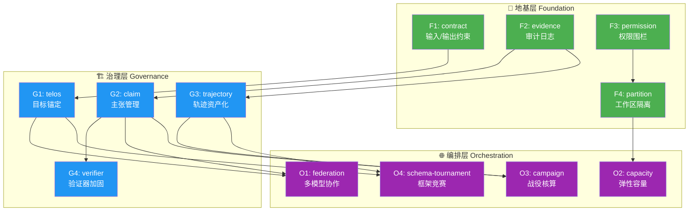

# Schema Sandbox：乐高式模块化架构

> **核心理念**：Schema Sandbox 不是一个你必须"全部采用或全部放弃"的庞然大物。
> 它是一盒乐高积木——你可以只用 1 块搭一个最小原型，也可以用 12 块搭一座城堡。

---

## 一、为什么必须模块化

V33 论文的问题不在于内容不好，而在于**呈现方式是一座金字塔**：你必须理解全部 4,697 行才能开始使用。这对绝大多数开发者是不可接受的。

正确的产品形态应该是：

```
                    ┌──────────────────────┐
                    │  完整研究平台 (全12模块) │  ← 1% 的用户需要
                    ├──────────────────────┤
                 ┌──┤  研究型 Agent (6-8模块) │  ← 5% 的用户需要
                 │  ├──────────────────────┤
              ┌──┤  │  安全 Agent (3-4模块)   │  ← 20% 的用户需要
              │  │  ├──────────────────────┤
           ┌──┤  │  │  结构化输出 (1-2模块)   │  ← 74% 的用户需要
           │  │  │  └──────────────────────┘
           ▼  ▼  ▼  ▼
        用户从底部进入，按需向上攀爬
```

---

## 二、12 块乐高积木

将 V33 的十层架构拆解为 **12 个独立可组合的模块**，分 3 个层级：

### 🧱 地基层（Foundation）—— 任何人都可以立即使用

| # | 模块名 | 一句话 | 独立价值 | 依赖 |
|:--|:---|:---|:---|:---|
| **F1** | `@sip/contract` | 输入/输出的 JSON Schema 约束 | 结构化输出不出格 | 无 |
| **F2** | `@sip/evidence` | 每个动作留痕的审计日志 | 可追溯、可审计 | 无 |
| **F3** | `@sip/permission` | 文件/网络/工具的权限围栏 | Agent 不越界 | 无 |
| **F4** | `@sip/partition` | 工作区隔离（Deno/WASI） | 多任务不互相污染 | F3 |

> **最简使用**：只装 `@sip/contract`，30 行代码就能让你的 Agent 输出符合 JSON Schema。

```typescript
// 最简形态：只用 F1
import { createGate } from '@sip/contract';

const gate = createGate({
  output: { type: 'object', properties: { answer: { type: 'string' }, confidence: { type: 'number', minimum: 0, maximum: 1 } }, required: ['answer', 'confidence'] }
});

const result = await gate.validate(llmOutput);
// → { valid: true, data: { answer: "...", confidence: 0.85 } }
// 或 { valid: false, violations: [...], fallback: "..." }
```

---

### 🏗️ 治理层（Governance）—— 需要"可信 Agent"的团队使用

| # | 模块名 | 一句话 | 独立价值 | 依赖 |
|:--|:---|:---|:---|:---|
| **G1** | `@sip/telos` | 目标锚定 + 漂移检测 + 停滞告警 | Agent 不跑偏 | F1 |
| **G2** | `@sip/claim` | 主张信封 + 证据成熟度 + 状态转换 | 结论有凭有据 | F2 |
| **G3** | `@sip/trajectory` | 轨迹记录 + 路线替换 + 失败资产化 | 失败也是资产 | F2 |
| **G4** | `@sip/verifier` | 验证器适配 + 加固检查 + 突变测试 | 验证不走过场 | G2 |

> **典型组合**：F1 + F2 + F3 + G1 = "不跑偏、不越界、留痕迹的安全 Agent"

```typescript
// 中等形态：F1 + F2 + G1
import { createGate } from '@sip/contract';
import { createLedger } from '@sip/evidence';
import { createTelos } from '@sip/telos';

const sandbox = compose(
  createGate({ output: mySchema }),
  createLedger({ retention: '30d' }),
  createTelos({
    goal: "分析竞品定价策略并给出建议",
    nonGoals: ["不修改数据库", "不发送邮件"],
    stagnation: { maxEquivalentRetries: 3, windowSteps: 10 }
  })
);

// sandbox.run() 现在会：
// 1. 检查每个输出是否符合 schema (F1)
// 2. 记录每个动作的审计日志 (F2)
// 3. 检测 Agent 是否偏离了"分析竞品定价"这个目标 (G1)
// 4. 如果 Agent 连续 3 次做等价操作，触发停滞告警 (G1)
```

---

### 🌐 编排层（Orchestration）—— 构建复杂研究/生产系统

| # | 模块名 | 一句话 | 独立价值 | 依赖 |
|:--|:---|:---|:---|:---|
| **O1** | `@sip/federation` | 多模型协作 + 类型化交接 + 关联审查 | 多模型不是投票机 | G1, G2 |
| **O2** | `@sip/capacity` | 弹性容量 + 到期租约 + 验证债务 | 算力不浪费 | F4 |
| **O3** | `@sip/campaign` | 战役核算 + 目标去重 + 凭证经济学 | 批量研究不重复 | G2, G3 |
| **O4** | `@sip/schema-tournament` | 竞争性 Schema 提案 + 等预算实验 | 框架可以被推翻 | G1, G3 |

---

## 三、5 个典型配方（Recipes）

就像做菜有菜谱，模块组合也有推荐配方：

### 配方 1：Hello World（1 模块）
```
F1
```
**场景**：我只想让 LLM 输出合法的 JSON。
**代码量**：~30 行。
**安装**：`npm install @sip/contract`

---

### 配方 2：安全 Agent（3 模块）
```
F1 + F2 + F3
```
**场景**：企业内部 Agent，需要权限控制和审计日志。
**代码量**：~200 行。
**安装**：`npm install @sip/contract @sip/evidence @sip/permission`

---

### 配方 3：可信研究助手（5 模块）
```
F1 + F2 + F3 + G1 + G2
```
**场景**：AI 辅助研究，需要目标锚定、主张管理、证据追踪。
**代码量**：~800 行。

---

### 配方 4：多模型协作平台（8 模块）
```
F1 + F2 + F3 + F4 + G1 + G2 + G3 + O1
```
**场景**：联邦多模型编排，不同模型扮演不同角色。
**代码量**：~3,000 行。

---

### 配方 5：完整研究平台（全 12 模块）
```
F1 + F2 + F3 + F4 + G1 + G2 + G3 + G4 + O1 + O2 + O3 + O4
```
**场景**：V33 论文描述的完整架构。
**代码量**：~38-63k 行（论文估算）。

---

## 四、模块之间的依赖关系



**关键设计原则**：
- 每个模块可以**独立安装、独立使用**
- 依赖关系是**可选增强**，不是硬性前置条件
- 例如：`@sip/claim` 在没有 `@sip/evidence` 的情况下也能工作，只是不会自动记录审计日志

---

## 五、与 V33 论文的映射关系

| V33 论文章节 | 对应模块 | 说明 |
|:---|:---|:---|
| S1 领域基础 + S2 输入约束 + S8 输出约束 | **F1** contract | 合并为统一的输入/输出契约 |
| S3 路由 + S6 工具 + S7 权限 | **F3** permission | 合并为统一的权限围栏 |
| EvidenceRecord + 审计日志 | **F2** evidence | 独立的审计追踪 |
| S4 分区 + 运行时隔离 | **F4** partition | 工作区隔离 |
| S10 Telos + GoalPreservationContract | **G1** telos | 目标锚定与漂移检测 |
| ResearchClaimEnvelope + 证据成熟度 | **G2** claim | 主张管理与状态转换 |
| 研究轨迹账本 + 路线替换 + 生产性否决 | **G3** trajectory | 轨迹资产化 |
| 验证器加固 + 形式化绑定 + 突变测试 | **G4** verifier | 验证器适配与加固 |
| Section 9 联邦多模型 | **O1** federation | 多模型协作编排 |
| Section 3.7 容量弹性 + H0-H3 | **O2** capacity | 弹性容量控制 |
| 3.4.15-16 战役/子集 + 凭证经济学 | **O3** campaign | 战役核算与目标去重 |
| 3.5 可破坏 Schema + 元沙箱 | **O4** schema-tournament | 竞争性框架评估 |

---

## 六、compose() 的设计哲学

模块之间通过一个统一的 `compose()` 函数组合，而不是继承或嵌套：

```typescript
import { compose, createSandbox } from '@sip/core';
import { contract } from '@sip/contract';
import { evidence } from '@sip/evidence';
import { permission } from '@sip/permission';
import { telos } from '@sip/telos';

// 用户只组合自己需要的模块
const sandbox = createSandbox(
  compose(
    contract({ output: myOutputSchema }),
    evidence({ retention: '90d', tier: 'A2' }),
    permission({ fs: ['/workspace'], net: ['api.openai.com'], tools: ['search', 'calculate'] }),
    telos({ goal: "...", nonGoals: ["..."], stagnation: { ... } })
  )
);

// 每个模块注册自己的 pre/post 钩子
// compose() 按声明顺序串联它们
const result = await sandbox.run(agentLoop);
```

**核心 API 设计**：
- `compose(...modules)` → 合并多个模块的钩子与策略
- `sandbox.run(fn)` → 在沙箱约束下执行函数
- `sandbox.inspect()` → 查看当前状态（目标、主张、轨迹……）
- `sandbox.export()` → 导出审计报告

每个模块只需实现一个统一接口：

```typescript
interface SipModule {
  name: string;
  version: string;
  hooks: {
    preAction?: (ctx: ActionContext) => Decision;
    postAction?: (ctx: ActionContext, result: any) => void;
    preOutput?: (ctx: OutputContext) => Decision;
    postOutput?: (ctx: OutputContext, result: any) => void;
    onStagnation?: (ctx: StagnationContext) => Signal;
    onClaim?: (ctx: ClaimContext) => Decision;
  };
  inspect?: () => ModuleState;
  export?: () => ModuleReport;
}
```

---

## 七、渐进升级路径

用户的典型成长路径：

```
第 1 天：  npm install @sip/contract
           "哦，结构化输出这么简单？"

第 1 周：  + @sip/evidence
           "审计日志自动就有了？"

第 1 月：  + @sip/permission + @sip/telos
           "Agent 不会越界了，也不跑偏了"

第 3 月：  + @sip/claim + @sip/trajectory
           "原来失败的尝试也能变成资产"

第 6 月：  + @sip/federation + @sip/capacity
           "多个模型协作，算力按需分配"

第 1 年：  + @sip/campaign + @sip/verifier + @sip/schema-tournament
           "完整的研究治理平台"
```

> [!IMPORTANT]
> **每一步都有独立的价值交付。** 用户不需要理解"康德图式主义"就能用 `@sip/contract`。
> 但当他们需要更深的治理能力时，下一块积木已经准备好了。

---

## 八、这个设计对论文意味着什么

论文本身也应该按照这个模块结构重新组织公开版本：

| 公开文档 | 覆盖模块 | 页数 | 目标读者 |
|:---|:---|:---|:---|
| **Quick Start** | F1 | 3 页 | 所有开发者 |
| **安全 Agent 指南** | F1-F4 | 15 页 | 企业开发者 |
| **研究治理指南** | G1-G4 | 30 页 | AI 研究团队 |
| **平台架构手册** | O1-O4 | 50 页 | 平台架构师 |
| **完整规范（V33-KB）** | 全部 | 444k 字符 | 核心开发者 |

这样，44 万字符的知识库不再是一座令人望而生畏的高山，而是一个用户可以按需攀爬的阶梯。
